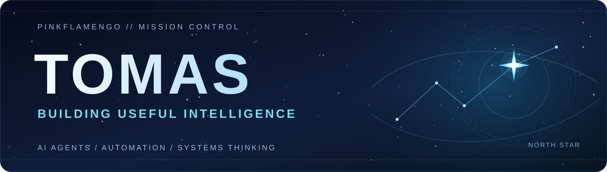

  

  <strong>AI agents &nbsp;·&nbsp; Automation &nbsp;·&nbsp; Systems thinking &nbsp;·&nbsp; Product building</strong>

  <em>From curiosity to capability.</em>

---

### 👋 Hello, I'm Tomáš.

I'm a **management & economics student in Slovakia** with a particular fascination for artificial intelligence and what happens when we move beyond chatting with models to **building systems that actually do useful work**.

I follow the AI frontier closely, enjoy experimenting with new tools, and care about the intersection of **technology, economics, and real-world impact**.

### 🛰️ Current missions

- **Agentic AI** — exploring autonomous workflows, tool use, orchestration, and AI that can carry work from idea to outcome.
- **Automation & personal systems** — making tasks, knowledge, and everyday processes work together with less friction.
- **AI-native products** — investigating how emerging capabilities can turn into practical software and viable businesses.
- **Learning in public** — documenting experiments, discoveries, and the lessons that survive contact with reality.

### 🧭 Guiding principles

> **Useful beats flashy.** The best demo is something that keeps working after the demo ends.

> **Stay curious, stay skeptical.** Test the frontier; don't confuse excitement with evidence.

> **Build, measure, improve.** A working prototype teaches more than a perfect plan.

### 📡 Transmission log

This profile is a **fresh start**, not a claim to a long list of shipped projects. As the workshop grows, this space will collect experiments, prototypes, notes, and real builds.

**Current status:** setting up the lab. More to come. ✨

  <a href="https://github.com/PinkFlamengo?tab=repositories">Explore repositories</a>
  &nbsp; · &nbsp;
  <a href="https://github.com/PinkFlamengo">GitHub profile</a>

  Made with curiosity, powered by coffee and compute. ☕🛰️

